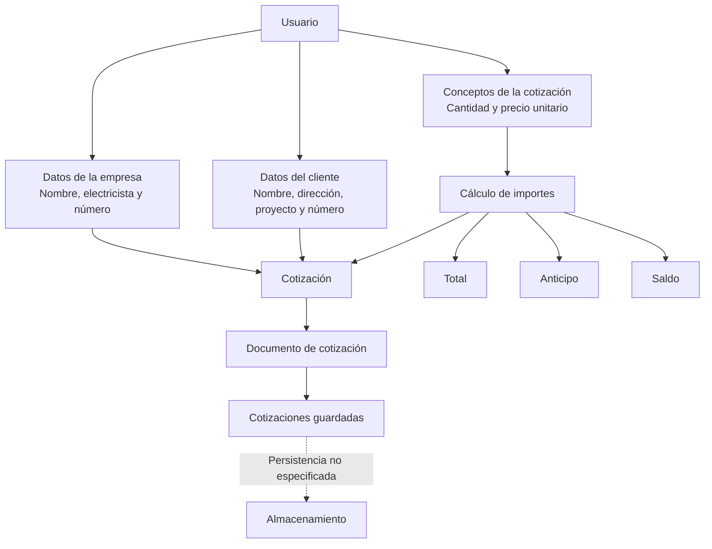

# Visión general de la arquitectura

La plantilla de cotización de **Pelico Servicios Eléctricos** organiza los datos de la empresa y del cliente, detalla los conceptos cotizados y presenta los importes de anticipo y saldo. Las cotizaciones guardadas se muestran como una sección aparte; el mecanismo de almacenamiento no está especificado en la información disponible.

