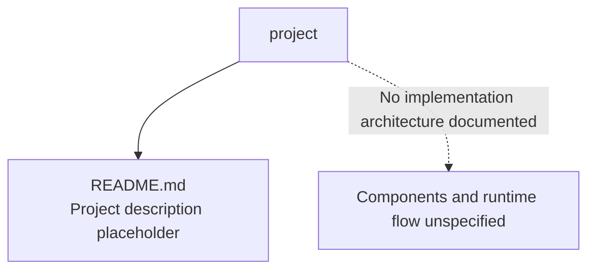

# Architecture overview

The repository currently documents only the project name; it does not define application components, services, data stores, or runtime flows. The diagram below reflects the repository's documented structure rather than implying an implementation architecture.

